# Janji
Saya Andina Dwi Listiana dengan NIM 2501065 mengerjakan TP 4 dalam mata kuliah Desain Pemrograman Berorientasi Objek untuk keberkahanNya maka saya tidak melakukan kecurangan seperti yang telah dispesifikasikan. Aamiin

# Desain dan Fungsi Program
Program PeopleData dibuat untuk mengelola data mahasiswa berbasis GUI. Dalam program ini saya membagi pengelolaan data ke dalam dua class utama yaitu Person dan PeopleMenu, serta menggunakan file PeopleMenu.form untuk merancang tampilan antarmuka program.

1. Person.java
   Class Person digunakan untuk merepresentasikan data mahasiswa. Di dalamnya terdapat lima atribut yaitu ID, Nama, TahunLahir, Kategori, dan Prodi. Setiap atribut memiliki getter dan setter yang digunakan untuk mengambil dan mengubah nilai data mahasiswa. Saya memisahkan data mahasiswa ke dalam class tersendiri supaya pengelolaan setiap objek mahasiswa lebih terstruktur.

2. PeopleMenu.java
   Class PeopleMneu menjadi bagian utama yang mengatur jalannya program, mulai dari menampilkan data sampai menjalankan operasi CRUD. Data mahasiswa disimpan menggunakan ArrayList kemudian ditampilkan dalam bentuk tabel menggunakan JTable dan DefaultTableModel.
   Ada beberapa fungsi yang terdapat pada class ini yaitu:
   1) insertData : untuk menambahkan data mahasiswa baru berdasarkan input pada form
   2) updateData: untuk memperbarui data mahasiswa berdasarkan baris yang dipilih
   3) deleteData : untuk menghapus data mahasiswa yang dipilih setelah memberikan konfirmasi untuk menghapus
   4) clearForm : untuk mengosongkan form dan membatalkan pemilihan data yang dilakukan (clear form)
   5) setTable : untuk menampilkan data mahasiswa yang tersimpan dalam daftarMahasiswa ke dalam tavel. Method ini akan dipanggil kembali setelah data ditambah, diubah (update), atau dihapus agar tampilan tabel selalu diperbaharui.
      
  Beberapa tambahan lainnya mengenai validasi untuk memastikan bahwa ID dan Nama tidak kosong dan harus diisi jika ingin menambahkan data, Tahun Lahir diisi dengan angka dan tidak boleh huruf serta tahun yang diisi harus berada dalam rentang waktu yang ditentukan, dan ID tidak bisa digunakan lagi jika ID sudah tercantum dalam tabel untuk menghindari adanya duplikasi data. Validasi tersebut dibuat supaya data yang dimasukkan lebih terjaga dan mengurangi kesalahan saat pengoperasian program.

3. PeopleMenu.form
   Pada bagian ini terdapat kolom input ID, Nama, Tahun Lahir, pilihan kategori mahasiswa, serta pilihan prodi. Untuk tabel di bawah kolom inputan berfungsi untuk menampilkan data mahasiswa yang tercatat. Di bawah tabel terdapat empat tombol untuk menjalankan operasi CRUD dan membatalkan input/clearform.
   Untuk atribut Kategori dan Prodi, saya menggunakan komponen JComboBox agar pengguna dapat memilih opsi yang tersedia tanpa perlu mengetikkan nilainya secara manual.

Desain program dibuat dengan memisahkan bagian data mahasiswa, logika pengelolaan data, dan rancangan antarmuka yaitu karena setiap bagian memiliki fungsi masing-masing sehingga program lebih mudah dipahami.

# Penjelasan Alur Program
Secara garis besar, saat program dijalankan, constructor PeopleMenu() akan mengatur pilihan Kategori dan Prodi, memasukkan data awal mahasiswa ke dalam ArrayList, serta memanggil method setTable() untuk menampilkan data ke tabel. Setelah itu, user dapat berinteraksi dengan form dan tombol yang tersedia untuk mengelola data mahasiswa.

Ketika user ingin menambahkan data, inputan dari form akan diperiksa terlebih dahulu sebelum data itu disimpan ke dalam ArrayList. Jika user memilih salah satu baris data mahasiswa pada tabel yang dilampirkan di bawah form, maka data mahasiswa tersebut akan ditampilkan kembali pada form sehingga dapat diubah atau dihapus. Proses pengubahan data dilakukan melalui tombol ubah, sedangkan penghapusan data dilakukan melalui tombol hapus, sebelum user menghapus, akan ditampilkan sebuah konfirmasi untuk meyakinkan apakah data yang pilih benar akan dihapus atau tidak.

Setelah operasi tambah, ubah, atau hapus berhasil dilakukan, tabel akan diperbarui agar menampilkan data terbaru. Tombol Batalkan dapat digunakan untuk mengosongkan form dan membatalkan pemilihan data.

Seluruh data mahasiswa selama program berjalan disimpan menggunakan ArrayList, sehingga perubahan data belum tersimpan secara permanen dan akan kembali ke data awal ketika program dijalankan ulang.

Urutan eksekusi program saya ini menjadi:
1. Constructor PeopleMenu() dijalankan ketika objek PeopleMenu dibuat.
2. Constructor menambahkan pilihan kategoriComboBox dan prodiComboBox.
3. Data awal mahasiswa dimasukkan ke daftarMahasiswa yang merupakan ArrayList untuk menyimpan objek Person.
4. Method setTable() dipanggil untuk mengambil data dari daftarMahasiswa dan menampilkan pada mahasiswaTable.
5. Constructor memasang event listener supaya tombol dan pemilihan baris tabel dapat menjalankan proses yang sesuai.
6. Ketika menekan tombol atau memilih baris tabel, program menjalankan method yang sesuai dengan interaksi tersebut. Setelah operasi tambah, ubah, atau hapus berhasil, method setTable() dipanggil kembali untuk memperbarui tampilan tabel.

# Dokumentasi
### 1. Tampilan Awal
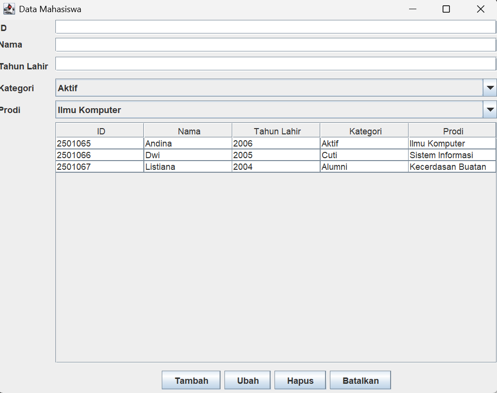

### 2. Tambah Data
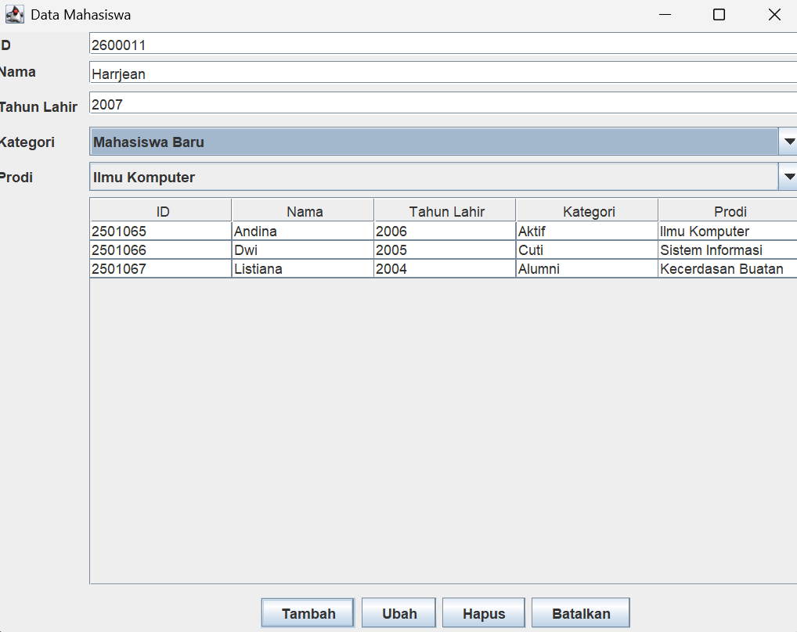

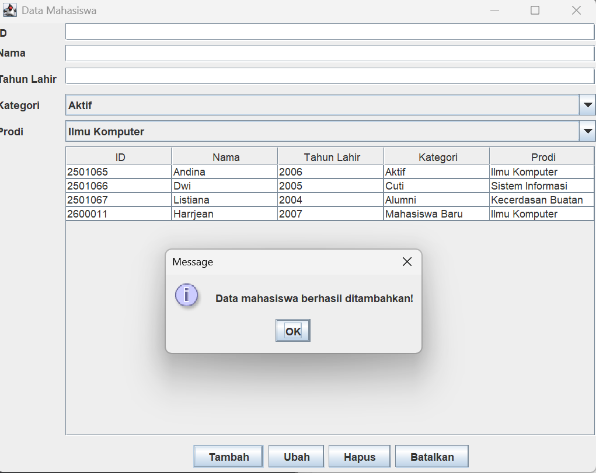

### 3. Ubah Data
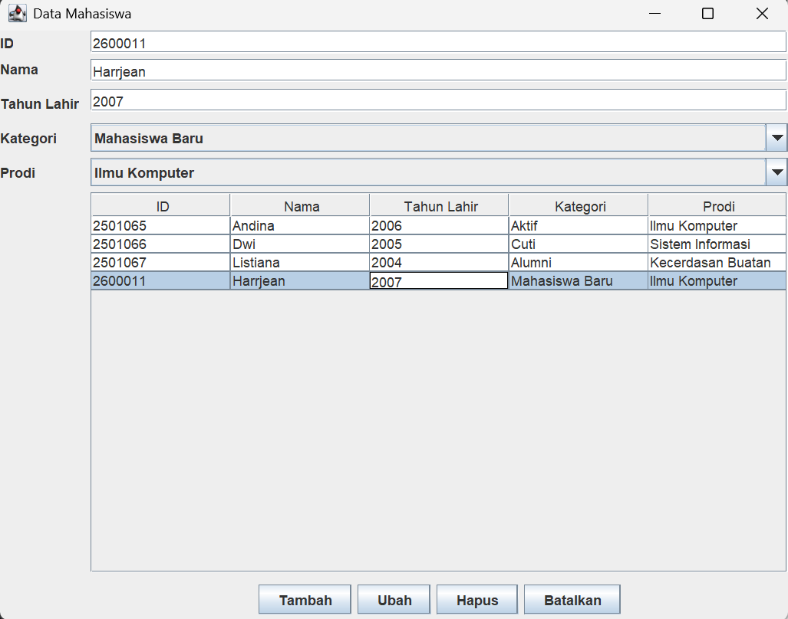

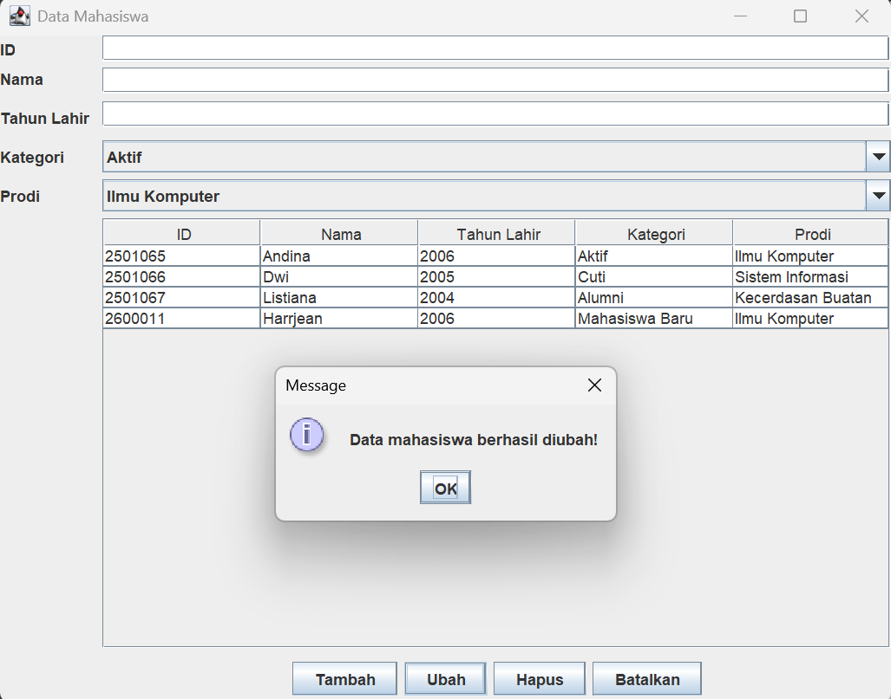

### 4. Hapus Data
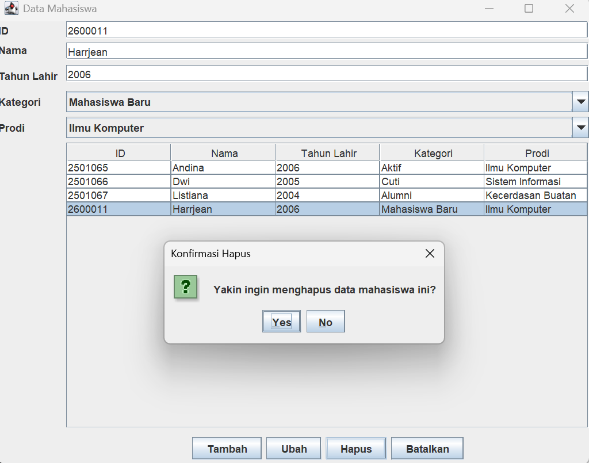

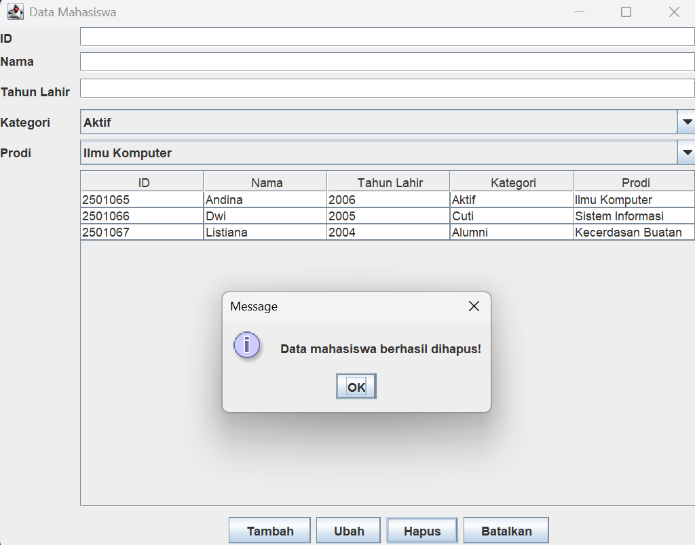

### 5. Batalkan
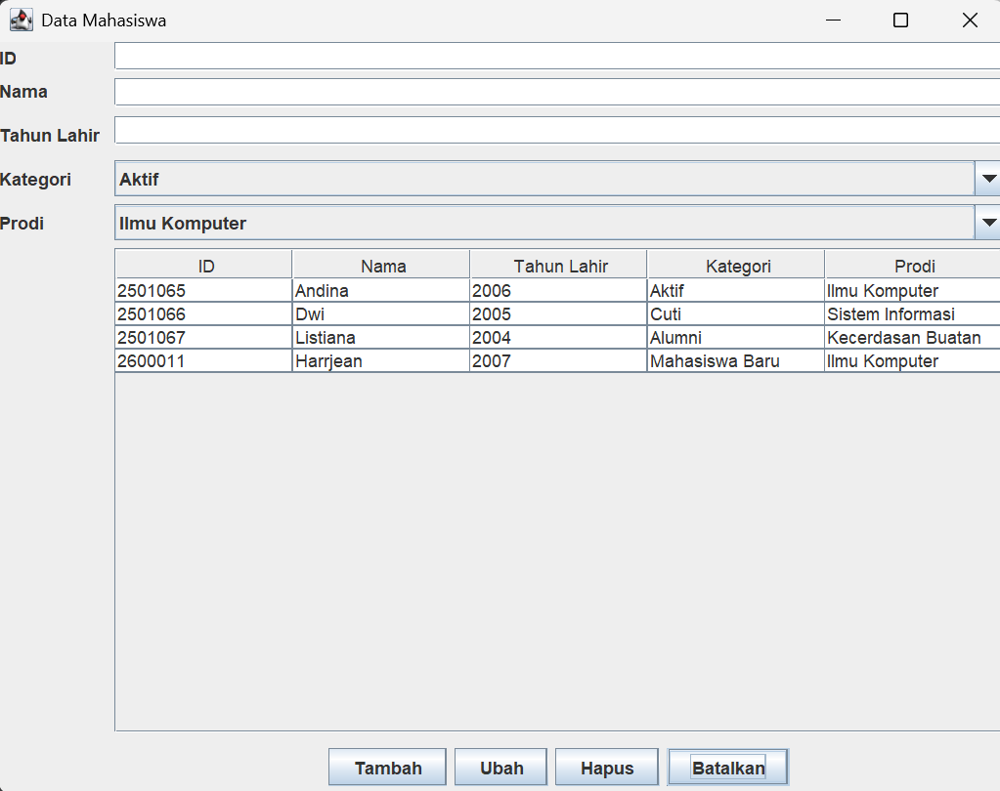

### 6. Validasi Input
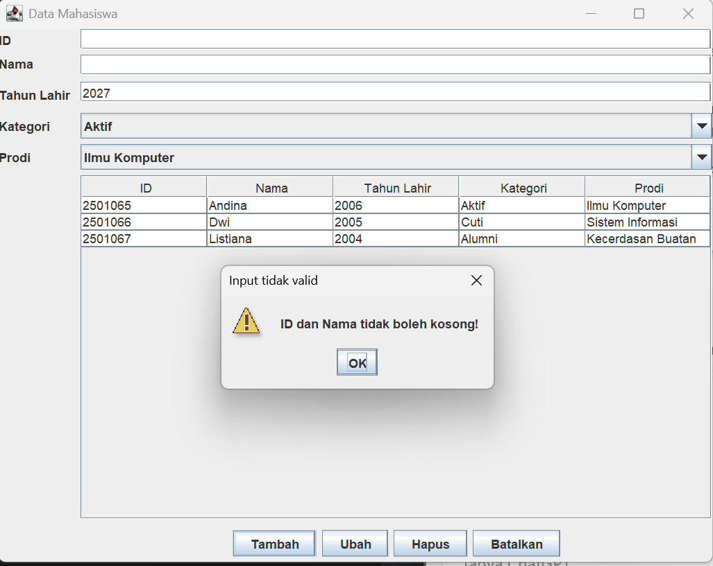

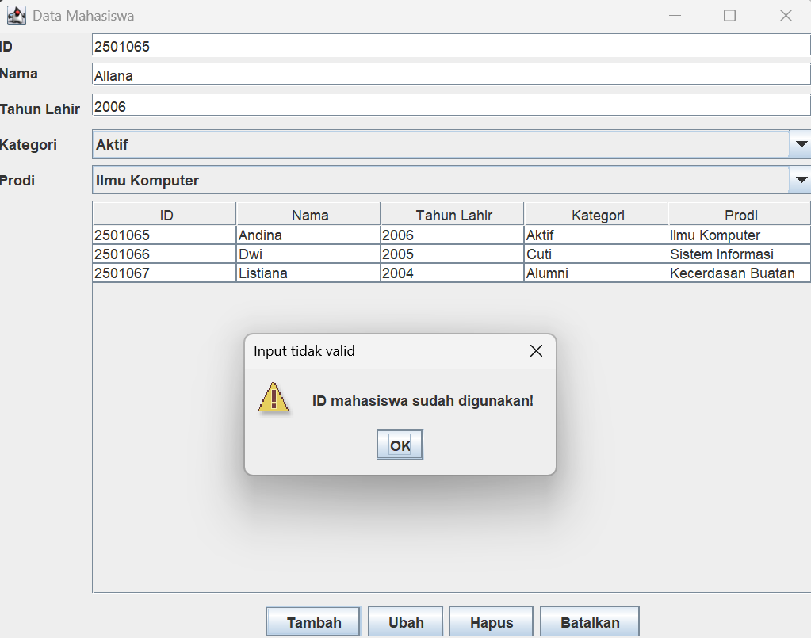

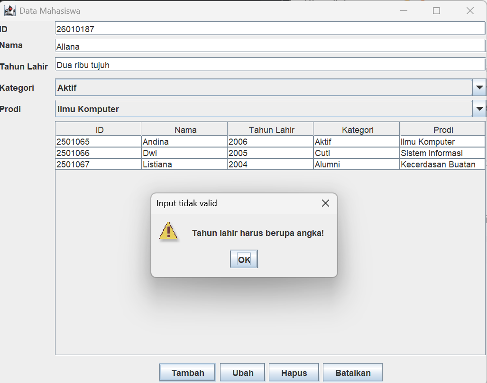

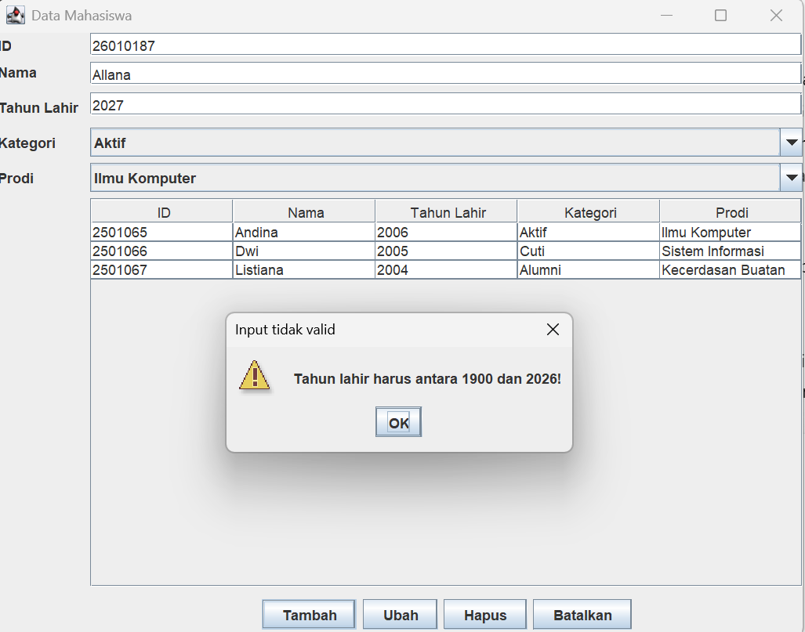
